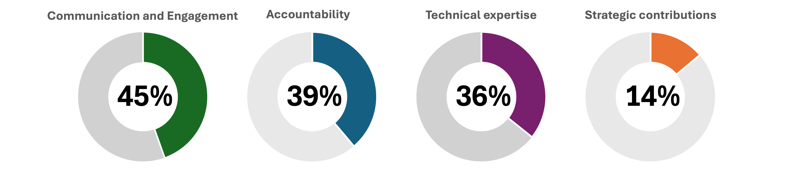

# UK TRE Community Documentation Review (2025)

## Purpose

This review was undertaken by @cassgvp while UK TRE was resourced by the Alan Turing Institute, at the close of the Institute's responsibilities for the community.
It was carried out alongside the [RCM teams sunsetting workflow](https://github.com/rcmcooperative/partner-template/blob/main/assets/RCM-sunsetting.drawio.pdf), with the aim of prioritising sunsetting-related activities and identifying significant documentation gaps.

**UK TRE was not closing.**
The community aimed to continue to operate under the CMWG model; this review supported a clean handover rather than a wind-down.

For each documentation theme, the review aimed to identify where the appropriate material lived, and to flag what was incomplete or not applicable.
A standing condition of the review was that access to any linked material or infrastructure must not depend on closed institutional mechanisms or approvals — anything gated behind Turing-only SharePoint or Turing-managed Google Drive access was noted as a risk to resolve, not treated as sufficient in itself.

## Process

1. **Material source mapping** — all known locations holding UK TRE community material were listed and access-checked: the public website, the `community-management` and Hugo website GitHub repos and project boards, the UK TRE Google Drive, two Turing SharePoint sites, the UK TRE Zenodo community, HackMD note archives, and Cass's personal HackMD notes.
2. **Theme-by-theme audit** — material was organised into six activity groupings (steady-state, recurrent, one-off, close, scientific/community outputs, and GitHub housekeeping), each broken into specific documentation themes (e.g. Governance, Comms channels, Financial reporting).
3. **Gap identification** — for each theme, existing material was linked and gaps, missing owners, or undocumented processes were flagged in-line (marked with `==...==` in the source).
4. **Outcome** — Documentation of the community knowledge and materials against a framework of responsibilites listed in the  [RCM Skills Wheel](https://arxiv.org/abs/2409.00108)

## Material sources reviewed 
**NOTE ALL LINKS BELOW HAVE BEEN REVIEWED FOR ACCESS. Sharepoint links are available to Turing staff only, and google drive links are available to WMWG members only (currently managed by David Sarmiento Perez)**
- [x] [Website: UKTRE Current](https://www.uktre.org/)
- [x] [Website: Hugo MVP](https://uk-tre.github.io/hugo-website/) 
- [x] [Github repo: UKTRE Community Management](https://github.com/uk-tre/community-management)
- [x] [Github repo: UK TRE projects](https://github.com/orgs/uk-tre/projects)
- [x] [Google drive: UK TRE Community Management](https://drive.google.com/drive/folders/1yH05sKEZxvHqQwjEkUDIsQdPDMZxY_g2?usp=drive_link)
    - [ ] [Working groups folder](https://drive.google.com/drive/folders/1Wd4iXiDb80IR4GBno_d1YNWtcDoQfwDB?usp=drive_link)
    - [ ] [Meetings folder](https://drive.google.com/drive/folders/1sF0Mn59pDUQED0JnzTbqMBWADTs5Sebp?usp=drive_link)
- [x] [Turing sharepoint (DSH RAM)](https://thealanturininstitute.sharepoint.com/sites/SafeHaven/Shared%20Documents/Forms/AllItems.aspx?id=%2Fsites%2FSafeHaven%2FShared%20Documents%2FRAM&viewid=10151919%2Deeef%2D4a8b%2Db4c0%2D26a3b155773b)
- [x] [Turing sharepoint UK TRE](https://thealanturininstitute.sharepoint.com/sites/SafeHaven/Shared%20Documents/Forms/AllItems.aspx?id=%2Fsites%2FSafeHaven%2FShared%20Documents%2FUK%20TRE%20Community&viewid=10151919%2Deeef%2D4a8b%2Db4c0%2D26a3b155773b)
- [x] [UK TRE Zenodo community](https://zenodo.org/communities/uktre/records?q=&l=list&p=1&s=10&sort=newest)
- [ ] [Downloads of HackMDs (Turing Sharepoint)](https://thealanturininstitute.sharepoint.com/:f:/s/SafeHaven/EvUnxGKW3zpOrRqr2TfkfYwBeejM_70BDMMxo0iN64AJ2A?e=E2zYCf)
- [x] [Cass' UK TRE hackmd](https://hackmd.io/@cassgvp/BJN4r07Dyx) <mark>This needs to be downloaded to cryptdrive, internal only</mark>

## Outcomes

The audit's single clearest recommendation was that the new **Hugo website** (`uk-tre.github.io/hugo-website`) already contained placeholders for nearly everything in scope, and that the priority action was to **consolidate existing scattered material into it and identify what was genuinely missing**, rather than build fresh documentation from nothing.

None of the documentation themes below were marked complete at the time of review — every top-level theme checkbox was left open, even where substantial material existed, because material was scattered, partly access-restricted, or not yet consolidated into a single canonical location.

---

## Materials by RCM skill theme

Grouped under the RCM Skills and Competency Framework (Sharan, Karoune, Hellon, Gould Van Praag et al., 2024).

Each row below links to its own list of source material (list of links).

**Status** is a classification of how much usable material was identified for each theme. Items are classified as below: 

- Present: Meaningful, fairly solid material was found for this theme (e.g. Presentations, SATRE recommendations).
- Open: Some material exists, but it's incomplete, scattered across multiple locations, or has open gaps/placeholders flagged.
- Missing: Nothing substantive was found at all.

**Completeness** is an estimate of how much relevant material was found versus flagged as missing. Treat these as indicative, not exact counts. Rows are ordered by completeness.

Figure 1: Estimated coverage of documentation relevant to the performance of RCM activities under activity groups. 

### Communication and Engagement

| Theme | Status | Completeness | Notes | Links |
|---|---|---|---|---|
| Presentations | Present | 90% | Good coverage — HDR UK 2024 slides, recording, and a 2024–2025 archive. | [↓ list](#cee-11) |
| Events archive | Open | 80% | Strong Zenodo record for 2023–2024; open question on consistent DOI'ing of events. | [↓ list](#cee-4) |
| Code of Conduct, incl. implementation after RCM close | Open | 70% | CoC exists in `.github` repo; no note on continuity of enforcement post-handover. | [↓ list](#cee-2) |
| Events guides (set up, comms, analysis, reporting) | Open | 60% | Reasonable coverage; several supporting issues (templates, dates, Luma set-up) still open. | [↓ list](#cee-5) |
| Calendar | Open | 60% | Teamup calendar identified and embedded on the website; administrator left unfilled. | [↓ list](#cee-3) |
| Comms channels usage and infrastructure | Open | 50% | Channels and email addresses all identified; admin ownership left unfilled for both JISC and Slack. | [↓ list](#cee-1) |
| Community narrative | Open | 40% | RAM narrative and a Hugo issue exist; no consolidated public narrative confirmed. | [↓ list](#cee-7) |
| Setting up Working Groups and template docs (comms aspects) | Open | 30% | Cyber Security WG example exists; comms set-up not confirmed as a repeatable template. | [↓ list](#cee-8) |
| Newsletters | Open | 10% | Only a proposing GitHub issue found — no process or output material. | [↓ list](#cee-6) |
| Working group docs / comms spaces set up per WG | Open | 0% (0/8 ticked) | No individual WG had its docs/comms space confirmed as set up. | [↓ list](#cee-9) |
| Scicom (blogs etc.) | Missing | 0% | No material identified at all. | [↓ list](#cee-10) |

### Strategic Contributions

| Theme | Status | Completeness | Notes | Links |
|---|---|---|---|---|
| Governance | Open | 65% | Substantial material, but spread across old website, Hugo site, GitHub and Drive; several sub-issues still open. | [↓ list](#sc-2) |
| Strategy design | Open | 40% | High-level focus areas documented; no fuller strategy document identified. | [↓ list](#sc-5) |
| Ways of Working | Open | 10% | No single document; sub-topics scattered across separate open issues. | [↓ list](#sc-1) |
| Stakeholder mapping and analysis (incl. live data, org charts) | Missing | 10% | Only a non-transferable Turing spreadsheet found; open issue to build from scratch. | [↓ list](#sc-4) |
| Community roadmap and milestones | Missing | 0% | Only an open issue to create one; a 2035 Vision breakout output couldn't be located. | [↓ list](#sc-3) |
| Plan for next phase, incl. Community Leadership pipeline | Missing | 0% | No material identified. | [↓ list](#sc-6) |
| Delivery plan for work/papers in progress, and related comms | Missing | 0% | No material identified. | [↓ list](#sc-7) |
| Closure report | Missing | 0% | No material identified (UK TRE was not in fact closing). | [↓ list](#sc-8) |
| KPIs and measures of success | Missing | 0% | No material identified. | [↓ list](#sc-9) |

### Technical Expertise

| Theme | Status | Completeness | Notes | Links |
|---|---|---|---|---|
| Recommendations / Best practice | Present | 90% | Strong existing material via SATRE. | [↓ list](#te-3) |
| Methods documentation | Present | 80% | TRE Usability Principle and SATRE evaluation workshop records identified. | [↓ list](#te-4) |
| File storage access and conventions | Open | 40% | Repo structure identified; admin names and basic repo docs (README etc.) largely missing. | [↓ list](#te-1) |
| GitHub issues and project boards | Open | 20% | Large backlog (49 open issues, 5 open PRs) identified; not yet actioned. | [↓ list](#te-2) |
| Training resources | Open | 20% | Only placeholders found on the Hugo Community Resources page. | [↓ list](#te-5) |
| Code | Missing | 0% | No material identified. | [↓ list](#te-6) |
| FAIR data | Missing | 0% | No material identified. | [↓ list](#te-7) |

### Accountability

| Theme | Status | Completeness | Notes | Links |
|---|---|---|---|---|
| Grant applications and outcomes | Present | 85% | Strong coverage across DARE, Zenodo, and UKRI sources, though several access-restricted. | [↓ list](#acc-4) |
| Impact evidence | Present | 85% | NHS DSP accreditation, DSH impact story, DARE submission, Zenodo stats all identified. | [↓ list](#acc-6) |
| Financial reporting | Present | 70% | RAM description located, but access-restricted to Turing staff. | [↓ list](#acc-1) |
| Research about the community (surveys, breakout data) | Open | 60% | Survey and breakout data located, on restricted SharePoint/Drive. | [↓ list](#acc-5) |
| Meeting minutes templates and archiving, Chairs' role | Open | 50% | Minutes archive and a placeholder template exist; several supporting issues still open. | [↓ list](#acc-2) |
| Other policies (e.g. authorship) | Missing | 0% | No material identified. | [↓ list](#acc-3) |
| Prizes / recognition | Missing | 0% | No material identified. | [↓ list](#acc-7) |
| Research proposals | Missing | 0% | No material beyond what's covered under grant applications. | [↓ list](#acc-8) |
| Papers | Missing | 0% | No material identified. | [↓ list](#acc-9) |

---

## Link lists

### Communication and Engagement

**Comms channels usage and infrastructure**
- [Join JISC list](https://www.jiscmail.ac.uk/cgi-bin/wa-jisc.exe?SUBED1=UK-TRE-COMM&A=1)
- [Slack invite](https://join.slack.com/t/uktrecommunity/shared_invite/zt-2gep86apc-QMLyIdrC2oIIsxTRzLxUqA)
- [Slack workspace management issue](https://github.com/uk-tre/community-management/issues/12)
- [Get involved (website)](https://www.uktre.org/en/latest/structure/community-management.html#get-involved)
- [DNS registration issue](https://github.com/uk-tre/community-management/issues/169)
- [New website](https://uk-tre.github.io/hugo-website/)
- [Issue template](https://github.com/uk-tre/community-management/blob/main/.github/ISSUE_TEMPLATE/general.yml)
- [Comms channels description](https://github.com/uk-tre/community-management/blob/main/governance/Community_spaces.md)
- [Get involved (Hugo)](https://uk-tre.github.io/hugo-website/getinvolved/)
- [Branding materials](https://drive.google.com/drive/folders/1YNno3UHKL2m7XMBwjSOjoEL1C_w5k-4T?usp=drive_link)
- [Archived comms plan](https://docs.google.com/document/d/13HaeI34LK59sQa222F0fmrBmOT4P34N_Ecn8-JWCo3w/edit?usp=sharing)
- [JISC request template](https://docs.google.com/document/d/1fCpRelnIgOpOXI2YPBEhY3GuB9l7ZAQ7mnmMylPUYwM/edit?usp=drive_link)
- [Social media accounts issue](https://github.com/uk-tre/community-management/issues/13)
- [@uktre.org emails issue](https://github.com/uk-tre/community-management/issues/43)
- [Review community spaces issue](https://github.com/uk-tre/community-management/issues/45)
- [Discussion issue template issue](https://github.com/uk-tre/community-management/issues/93)

**Code of Conduct, incl. implementation after RCM close**
- [Code of Conduct](https://github.com/uk-tre/.github/blob/main/CODE_OF_CONDUCT.md)

**Calendar**
- [Teamup calendar](https://teamup.com/ksbqmbhymxdbu454aw)
- [Embedded on website](https://www.uktre.org/en/latest/events/index.html)

**Events archive**
- [Website events section](https://www.uktre.org/en/latest/structure/index.html#quarterly-community-events)
- [Community workshops](https://www.uktre.org/en/latest/events/wg_workshops/index.html#community-workshops)
- [Events upcoming and archive (Hugo)](https://uk-tre.github.io/hugo-website/events/)
- [Quarterly Dec 2024 slides](https://zenodo.org/records/14990114)
- [Annual Sept 2024 slides](https://zenodo.org/records/13909022)
- [Lightning talks Sept 2024](https://zenodo.org/records/13908460)
- [Quarterly Dec 2023 slides](https://zenodo.org/records/10370931)
- [Annual Sept 2023 slides](https://zenodo.org/records/8376131)

**Events guides (set up, comms, analysis, reporting)**
- [Planned meetings](https://www.uktre.org/en/latest/events/wg_workshops/index.html#planned-meetings)
- [Aims and structure of events](https://www.uktre.org/en/latest/events/wg_workshops/index.html#background)
- [Prompts for quarterly meetings](https://github.com/uk-tre/community-management/blob/main/events/templates/prompts_for_sessions.md)
- [Events management (Hugo)](https://uk-tre.github.io/hugo-website/about/governance/events-management/)
- [RAM description of duties](https://thealanturininstitute.sharepoint.com/:w:/s/SafeHaven/ES1U8d2aBCZCmGO4lu7haKQBLr2w7S_lPZLxNp2iu2fy_g?e=xevV7V)
- [Sept 2023 call recordings](https://thealanturininstitute.sharepoint.com/:f:/s/SafeHaven/EpI0u7hye2xLsKlCYz2Y1xYBPgkKIVMY-wd3MAYoGzjTfg?e=brLz1i)
- [Quarterly events template issue](https://github.com/uk-tre/community-management/issues/77)
- [Document events set-up issue](https://github.com/uk-tre/community-management/issues/20)
- [2025 quarterly dates issue](https://github.com/uk-tre/community-management/issues/128)
- [Luma set-up notes (Cass' HackMD)](https://hackmd.io/@cassgvp/BJN4r07Dyx#Notes-Setting-up-for-March-online-event)

**Newsletters**
- [Newsletter proposal issue](https://github.com/uk-tre/community-management/issues/50)

**Community narrative**
- [RAM narrative](https://thealanturininstitute.sharepoint.com/:w:/s/SafeHaven/ES1U8d2aBCZCmGO4lu7haKQBLr2w7S_lPZLxNp2iu2fy_g?e=yOjGoX)
- [Hugo website issue 18](https://github.com/uk-tre/hugo-website/issues/18)

**Setting up Working Groups and template docs (comms aspects)**
- [WG intro](https://www.uktre.org/en/latest/structure/index.html#working-groups)
- [Cyber Security charter](https://docs.google.com/document/d/1KLIeB4uDDxwYT7pxj5ImHa5p_3wJ2KILsVKuAl7LQlM/edit?usp=sharing)
- [Cyber Security webpage](https://www.uktre.org/en/latest/structure/cybersecurity-risk.html)
- [Cyber Security repo](https://github.com/uk-tre/cybersec-wg)
- [WGs set-up (Hugo)](https://uk-tre.github.io/hugo-website/about/governance/working-groups/)
- [WG docs placeholders (Hugo)](https://uk-tre.github.io/hugo-website/groups/current/community_management/)
- [RAM description of WG set-up](https://thealanturininstitute.sharepoint.com/:w:/s/SafeHaven/ES1U8d2aBCZCmGO4lu7haKQBLr2w7S_lPZLxNp2iu2fy_g?e=yOjGoX)

**Working group docs / comms spaces set up per WG**
(Cybersecurity, Extending Control, Funding and Sustainability, Information Governance, SATRE, SDE/TRE Terminology, TRE Glossary, Open Source and Open Standards — none confirmed set up)
- [Out-of-date PR on WG process](https://github.com/uk-tre/community-management/pull/54)
- [Glossary WG set-up issue](https://github.com/uk-tre/community-management/issues/113) (and issues 114–119 for other WGs)

**Scicom (blogs etc.)**
- No material identified.

**Presentations**
- [HDR UK 2024 slides](https://docs.google.com/presentation/d/1f-iXMm8uyRv4kRtTjxH_qJxh8MISvKa8imSVtmhuCc0/edit?usp=sharing)
- [Recording](https://www.youtube.com/watch?v=yY8xo96gIFs)
- [2024–2025 archive](https://drive.google.com/drive/folders/1rBL-tl9zbEROC6zovMznSkkCRTsJVR5q?usp=drive_link)

### Strategic Contributions

**Ways of Working**
- [Capture issue](https://github.com/uk-tre/community-management/issues/18)
- [Purpose/values issue](https://github.com/uk-tre/community-management/issues/31)
- [Hugo website issue 19](https://github.com/uk-tre/hugo-website/issues/19)
- [GitHub roles/responsibilities issue](https://github.com/uk-tre/community-management/issues/3)
- [Unify GitHub labels issue](https://github.com/uk-tre/website/issues/22)
- [Project board how-to issue](https://github.com/uk-tre/community-management/issues/33)
- [Review the issues! issue](https://github.com/uk-tre/community-management/issues/121)

**Governance**
- [Community structure](https://www.uktre.org/en/latest/structure/index.html)
- [Community management and engagement](https://www.uktre.org/en/latest/structure/community-management.html#community-management-engagement)
- [Newcastle Commitment (repo)](https://github.com/uk-tre/website/blob/main/docs/newcastle-commitment/index.md)
- [Roles and responsibilities](https://www.uktre.org/en/latest/structure/community-management.html#roles-and-responsibilities)
- [Governance docs PR](https://github.com/uk-tre/community-management/pull/66)
- [Newcastle Commitment (website)](https://www.uktre.org/en/latest/newcastle-commitment/index.html)
- [Named leaders and responsibilities](https://github.com/uk-tre/community-management/blob/main/governance/community_roles.md)
- [Consensus review and objection management (Hugo)](https://uk-tre.github.io/hugo-website/about/governance/consensus-review-objection/)
- [Roles and membership (Hugo)](https://uk-tre.github.io/hugo-website/about/governance/roles-and-membership/)
- [Roles/responsibilities issue](https://github.com/uk-tre/community-management/issues/18)
- [Steering group (Hugo)](https://uk-tre.github.io/hugo-website/about/governance/steering-group/)
- [Newcastle Commitment (Hugo)](https://uk-tre.github.io/hugo-website/about/governance/newcastle-commitment/)
- [Draft docs (Drive)](https://drive.google.com/drive/folders/1Lf_ZYSc_No0Egh0e7iRSiCoWoqnMeOUf?usp=drive_link)
- [CMWG Co-Chair details](https://docs.google.com/spreadsheets/d/1cbzgeIstM2mazE-i424Ah6DDn8Qt68QVS5Unvyjh3_Q/edit?usp=sharing)
- [Governance diagram](https://drive.google.com/file/d/1xsYB7qS1l4pdi1ZgdKy5Dl0t6CTWMPpK/view?usp=sharing)
- [Hugo website issue 17](https://github.com/uk-tre/hugo-website/issues/17)
- [Objection issue template issue](https://github.com/uk-tre/community-management/issues/88) ([PR](https://github.com/uk-tre/community-management/pull/73))
- [Endorsement of WG outputs issue](https://github.com/uk-tre/community-management/issues/89)
- [Adding new Chairs issue](https://github.com/uk-tre/community-management/issues/91)
- [Removing a Chair issue](https://github.com/uk-tre/community-management/issues/92)
- [Steering Group term limits issue](https://github.com/uk-tre/community-management/issues/90)
- [Commercial orgs/vendors issue](https://github.com/uk-tre/community-management/issues/58)
- [Governance catch-all tracker issue](https://github.com/uk-tre/community-management/issues/65)
- [Governance issue template issue](https://github.com/uk-tre/community-management/issues/94)

**Community roadmap and milestones**
- [Create roadmap issue](https://github.com/uk-tre/community-management/issues/22)
- [2035 Vision breakout (Zenodo)](https://zenodo.org/records/13909022)

**Stakeholder mapping and analysis (incl. live data, org charts)**
- [RAM DSH CRM spreadsheet](https://thealanturininstitute.sharepoint.com/:w:/s/SafeHaven/EbHH6C2iylpEuggSWlKOpNQB0EVESkdz46qtluF-Um63wQ?e=cJ9240)
- [Build this issue](https://github.com/uk-tre/community-management/issues/23)
- [Capture relevant RDA WGs issue](https://github.com/uk-tre/community-management/issues/34)

**Strategy design**
- [Focus Areas](https://www.uktre.org/en/latest/structure/community-management.html#focus-areas)

**Plan for next phase, incl. Community Leadership pipeline**
- No material identified.

**Delivery plan for work/papers in progress, and related comms**
- No material identified.

**Closure report**
- No material identified.

**KPIs and measures of success**
- No material identified.

### Technical Expertise

**File storage access and conventions**
- [UK TRE org](https://github.com/uk-tre)
- [Website repo](https://github.com/uk-tre/website)
- [CMWG repo README](https://github.com/uk-tre/community-management/blob/main/README.md)
- [Governance document management (Hugo)](https://uk-tre.github.io/hugo-website/about/governance/governance-amendments/)
- [Resource management (Hugo)](https://uk-tre.github.io/hugo-website/about/governance/resources/)
- [Access rights](https://docs.google.com/document/d/1U4XstFbTwzAaCvaPVtFjZjbHDPOp46Bw0E-PQNbQVy8/edit?usp=sharing)

**GitHub issues and project boards**
- [Open PRs](https://github.com/uk-tre/community-management/pulls)
- [Open issues](https://github.com/uk-tre/community-management/issues)

**Recommendations / Best practice**
- [RAM description of SATRE](https://thealanturininstitute.sharepoint.com/:w:/s/SafeHaven/EVTek7x7A85BsFn7yDRelM4BS1HEMZJWMr6obY6L_S0AkA?e=dqvO7Y)
- [TRE Usability Principle](https://zenodo.org/records/10066800)
- [Full SATRE specification](https://zenodo.org/records/10053383)
- [SATRE specification (readthedocs)](https://satre-specification.readthedocs.io/)

**Methods documentation**
- [TRE Usability Principle](https://zenodo.org/records/10066800)
- [SATRE evaluation workshop](https://zenodo.org/records/10040590)

**Training resources**
- [Community Resources (Hugo)](https://uk-tre.github.io/hugo-website/resources/)
- [Hugo website issue 20](https://github.com/uk-tre/hugo-website/issues/20)

**Code**
- No material identified.

**FAIR data**
- No material identified.

### Accountability

**Financial reporting**
- [RAM description of funding/reporting](https://thealanturininstitute.sharepoint.com/:w:/s/SafeHaven/ES1U8d2aBCZCmGO4lu7haKQBLr2w7S_lPZLxNp2iu2fy_g?e=6l26pc)

**Meeting minutes templates and archiving, Chairs' role**
- [Note of notes placeholder](https://github.com/uk-tre/community-management/blob/main/meeting-notes/noteofnotes.md)
- [CMWG minutes 2023-11-21](https://github.com/uk-tre/community-management/blob/main/meeting-notes/CMWG-20231121.md)
- [Update Zoom link issue](https://github.com/uk-tre/community-management/issues/111)
- [Document this issue](https://github.com/uk-tre/community-management/issues/20)
- [Slack reminders issue](https://github.com/uk-tre/community-management/issues/49)
- [Notes from CMWG 2025-01-21–present (Cass' HackMD)](https://hackmd.io/@cassgvp/BJN4r07Dyx#Meeting-2025-01-21)

**Other policies (e.g. authorship)**
- No material identified.

**Grant applications and outcomes**
- [DARE UK Community Grant](https://thealanturininstitute.sharepoint.com/:f:/s/SafeHaven/EjysHwFka99NvnESJrv6VxAB9nEEULgPUDK1gVuVbm9Ppg?e=lu5RmT)
- [DARE Community Groups FC (Drive)](https://drive.google.com/drive/folders/1KJkctazgFdKkRpMYqzNYuWGTBltDGzcy?usp=drive_link)
- [DARE Phase 2 community call (Drive)](https://drive.google.com/drive/folders/1ZurZrRW0OCNxdbpsHaAM67aWvghEa-Jl?usp=drive_link)
- [UKRI Digital RTP Skills Network (Drive)](https://drive.google.com/drive/folders/11snfFmSEOuRJK4a-84mmmCDYxMJa6Wym?usp=drive_link)

**Research about the community (surveys, breakout data)**
- [Members survey results](https://thealanturininstitute.sharepoint.com/:x:/s/SafeHaven/ESkPJRBOf_dHm3d13A-cBmYBYVOTzn_sdFKlSsFQFvf2Yg?e=xaD7eh)
- [Breakout topic suggestions form](https://docs.google.com/forms/d/e/1FAIpQLSes2N38KjElxgfXXDUEVBeQ5g8qvneQS9Gr4alZki5s_4RRew/viewform?usp=sharing)
- [Breakout topic data](https://docs.google.com/spreadsheets/d/1WGRfVs6HNeV2Wn76v5sCaeBC1c80twOeIOJ49fnooFo/edit?usp=drive_link)
- [Members survey issue](https://github.com/uk-tre/community-management/issues/123)

**Impact evidence**
- [NHS DSP accreditation](https://thealanturininstitute.sharepoint.com/:w:/s/SafeHaven/EZcnVEimWShHmvoz7VwkKSMBsQlMNKfdnnaWRG0rArE-nQ?e=96c21e)
- [DSH Impact Story](https://thealanturininstitute.sharepoint.com/:w:/s/SafeHaven/EdwXpKjmm1tJjXmweaAvmdcBuH1t64eZUF98w_nyIFWTyw?e=ssnvnz)
- [DARE UK Interest Group Submission](https://docs.google.com/document/d/11M9fFfOg0973xChiDJ943vIjc3ZaKfWfS7zqmiJZ3ng/edit?usp=drive_link)
- [Zenodo community stats](https://zenodo.org/communities/uktre/records?q=&l=list&p=1&s=10&sort=newest)

**Prizes / recognition**
- No material identified.

**Research proposals**
- No material identified beyond what's covered under grant applications.

**Papers**
- No material identified.

---

## Access risk flagged in the original review

Two categories of material were identified as existing but held behind closed institutional access at the time of review, and were flagged as needing migration to open, community-managed infrastructure:

- **Turing SharePoint** (RAM/DSH, UK TRE Community folders) — Turing staff access only.
- **Google Drive** (Working Groups, Meetings folders) — UK TRE Working Group members only, managed at the time by David Sarmiento Perez.

This access dependency was the review's core sunsetting risk: documentation existing is not the same as documentation being reachable by the community that needs to sustain it.
